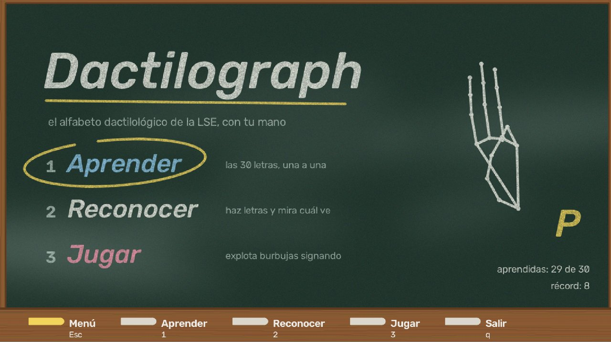
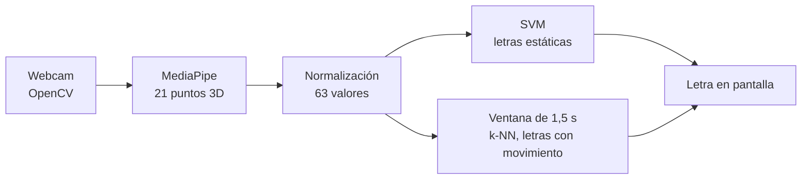
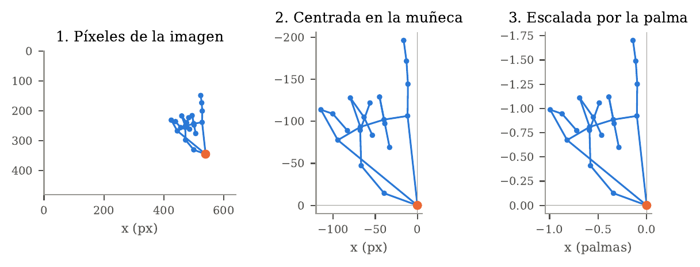
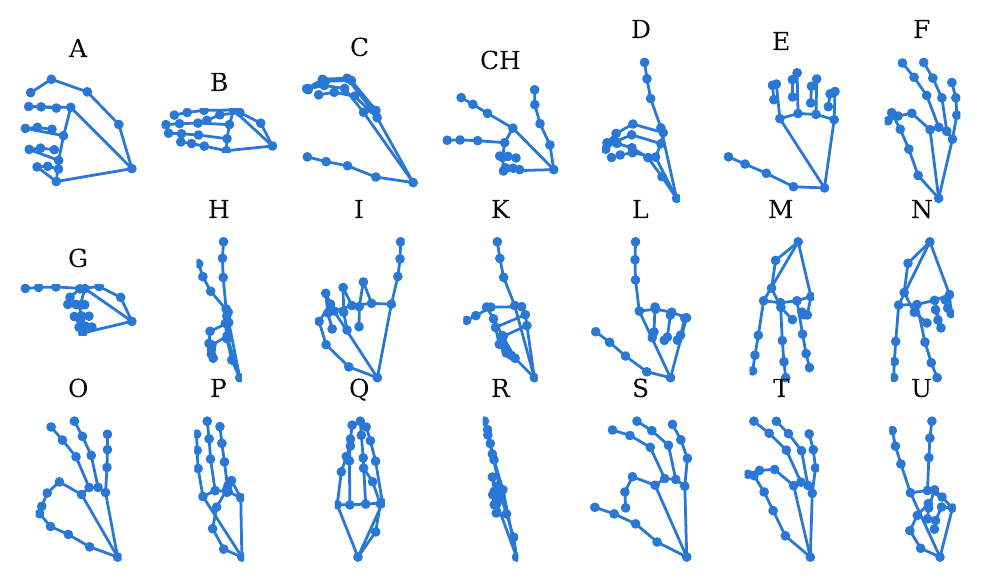
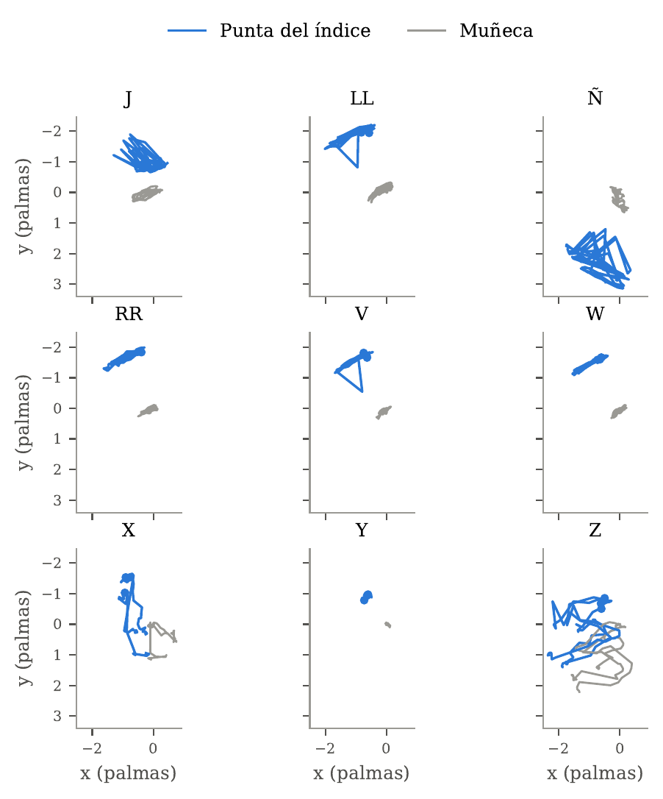
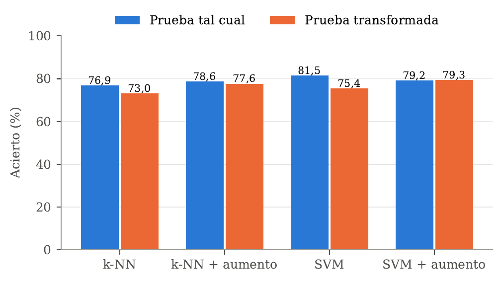
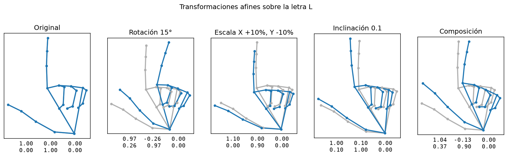
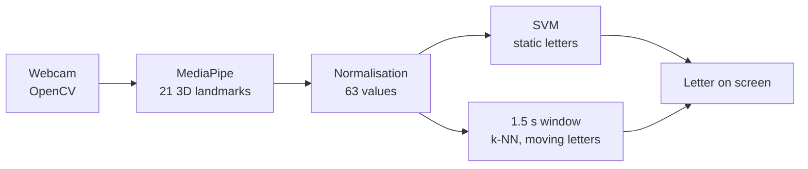

# Dactilograph

[](#español)
[](#english)



---

## Español

Reconocimiento en tiempo real del **alfabeto dactilológico de la Lengua de Signos Española (LSE)** mediante visión artificial, con una webcam normal, sin GPU y sin conexión.

### La idea

Una aplicación que, a través de la webcam, reconoce la letra del alfabeto dactilológico LSE que el usuario está haciendo con la mano y la muestra en pantalla.

No es un traductor de lengua de signos: la LSE funciona por signos con gramática propia. Este proyecto reconoce únicamente el **deletreo manual**, en el que cada letra corresponde a una postura de la mano o, en algunas letras, a una postura con movimiento.

Referencia del alfabeto: [Fundación CNSE, Dactilología](https://fundacioncnse.org/educa/bancolse/dactilologico.php) (30 signos realizados con una sola mano: A–Z con Ñ, más CH, LL y RR).

### Cómo funciona



1. **Captura:** OpenCV obtiene los fotogramas de la webcam.
2. **Detección:** MediaPipe extrae automáticamente los 21 puntos clave de la mano (x, y, z).
3. **Normalización:** las coordenadas se pasan a píxeles cuadrados, se trasladan respecto a la muñeca, se escalan por el tamaño de la palma (la distancia entre la muñeca y la base del dedo corazón, que no cambia entre el puño y la mano abierta) y se refleja la mano izquierda. Así el resultado no depende de la posición ni de la distancia a la cámara. El resultado es un vector de 63 números. La rotación no se normaliza a propósito: algunas letras, como la G y la H frente a la I y la U, se distinguen sobre todo por la orientación de la mano.
4. **Clasificación de letras estáticas:** una SVM recibe esos 63 números y devuelve la letra más probable con su seguridad. Una letra solo cuenta si se mantiene 0,4 s con una seguridad de al menos 0,6.
5. **Clasificación de letras con movimiento:** se guarda el último segundo y medio de fotogramas y un k-NN clasifica esa ventana a partir de la trayectoria de la muñeca y del índice y de la forma media de la mano. Una letra solo se acepta si sale igual en 3 clasificaciones seguidas, y después se espera 1 s antes de admitir otra.
6. **Resultado:** se muestra el vídeo con el esqueleto de la mano y la letra detectada.



### Aprendizaje supervisado

El modelo no recibe imágenes, sino los puntos de la mano ya extraídos por MediaPipe, lo que convierte el problema en una clasificación sencilla.

Los datos de entrenamiento son propios: mientras el usuario mantiene una letra delante de la cámara, se guardan en un CSV los puntos normalizados de cada fotograma junto con la letra correspondiente como etiqueta.

```
persona,letra,x0,y0,z0,...,x20,y20,z20
jose,A,0.00,0.00,0.00,...
```

Cada letra estática se grabó dos veces con dos cámaras distintas, 100 fotogramas por grabación. Las letras con movimiento tienen 3 secuencias por letra. Todo el dataset es de una sola persona.

| | Letras | Grabaciones | Fotogramas |
|---|---:|---:|---:|
| Estáticas | 21 | 42 | 4 200 |
| Con movimiento | 9 | 27 | 1 202 |



Para las letras con movimiento, cada muestra es una secuencia de unos 1,5 s, unos 45 fotogramas a 30 FPS. `data/sequences.csv` guarda una fila por fotograma con los puntos de MediaPipe sin normalizar, de modo que las características se pueden recalcular sin volver a grabar. Normalizar cada fotograma por separado borraría el desplazamiento de la mano, así que la trayectoria se mide desde la muñeca del primer fotograma.

Cada secuencia se describe con 143 números: la trayectoria de la muñeca y del índice en el plano, medida en palmas e interpolada a 20 instantes equiespaciados (80 valores), y la forma media de la mano en la ventana (63 valores). Al interpolar no importan la velocidad del gesto, los FPS de la cámara ni los fotogramas en los que se perdió la mano.

<p align="center"></p>

Los ejemplos de "ninguna letra con movimiento" se generan al entrenar a partir de las grabaciones de letras estáticas, colocando la mano con un pequeño temblor aleatorio para que no aprenda una quietud perfecta. También se pueden grabar con la etiqueta `-`.

### Evaluación y resultados

Mezclar fotogramas al azar entre entrenamiento y prueba da cifras engañosas: los 100 fotogramas de una grabación son casi idénticos, y un k-NN llegaba así al 99,8 %. Por eso cada grabación entera va a un solo pliegue y los modelos se evalúan siempre con grabaciones que no han visto.

| Letras estáticas | Tal cual | Mano girada |
|---|---:|---:|
| k-NN (k = 5) | 76,9 % | 73,0 % |
| k-NN + aumento | 78,6 % | 77,6 % |
| SVM (RBF) | 81,5 % | 75,4 % |
| **SVM + aumento** (elegido) | **79,2 %** | **79,3 %** |

<p align="center"></p>

"Mano girada" aplica una transformación afín aleatoria a cada fotograma de prueba. La SVM sin aumento acierta más con la mano tal cual, pero cae en cuanto gira un poco; con aumento se mantiene, así que es la que usa la aplicación. Va calibrada para que devuelva probabilidades, que la aplicación muestra como seguridad.

Para las letras con movimiento se elige un **k-NN con k = 1 y aumento**: F1 medio de 0,69 con secuencias no vistas y el 95,2 % de los negativos bien reconocidos. Una SVM descartaba casi todos los negativos como letras, y un k mayor haría que los negativos ganaran por número a las 3 muestras de cada letra.

### Aumento de datos con transformaciones afines

Los scripts de entrenamiento generan automáticamente copias de cada muestra con una transformación afín aleatoria sobre los puntos de la mano. Cada copia combina en una sola matriz una rotación de hasta ±15° alrededor de la muñeca, una escala distinta en X e Y de hasta ±10 % y una inclinación de hasta ±0,1. La traslación y la escala uniforme no aportan variedad por sí solas, porque la normalización las anula. En una secuencia, todos los fotogramas comparten la misma matriz para no inventar movimiento.



Las copias se añaden solo al entrenamiento de cada pliegue. Cada modelo se evalúa con y sin aumento, tanto con las muestras de prueba tal cual como con esas muestras transformadas, y se guarda el que mejor resultado da en conjunto. `--copias` indica cuántas copias se generan por muestra, y con `--copias 0` no se usa aumento.

`uv run scripts/plot_augmentation.py` dibuja una mano junto a sus transformaciones y las matrices usadas.

### Rendimiento

En portátiles con poca potencia, o sin cargador, los FPS de la cámara pueden bajar a unos 14. Como la trayectoria se interpola siempre a 20 instantes, la ventana de 1,5 s solo necesita 12 fotogramas con mano, unos 8 FPS: quitando fotogramas a las secuencias grabadas, la clasificación no empeora. La cámara se lee en un hilo aparte que guarda solo el último fotograma con su instante de captura, para no procesar imágenes atrasadas. La tecla `f` de la aplicación muestra los FPS.

### Alcance

- **Letras estáticas (21):** A, B, C, CH, D, E, F, G, H, I, K, L, M, N, O, P, Q, R, S, T, U.
- **Letras con movimiento (9):** J, LL, Ñ, RR, V, W, X, Y y Z.
- **Limitaciones:** el dataset es de una sola persona, así que no se ha medido cómo funciona con otras, y las letras con movimiento tienen pocas secuencias por letra. La aplicación sigue una sola mano, que basta para el alfabeto LSE.

### Tecnologías

- **Python**
- **OpenCV** — captura y visualización
- **MediaPipe** (Tasks API, `HandLandmarker`) — detección de los puntos de la mano
- **NumPy / pandas** — normalización y datos
- **scikit-learn** — clasificadores y métricas
- **matplotlib** — gráficas de resultados
- **uv** — entorno y dependencias · **ruff** — linter y formato · **pytest** — tests

### Instalación

Requiere [uv](https://docs.astral.sh/uv/), que instala por sí mismo la versión de Python adecuada.

```bash
uv sync                              # crea el entorno e instala las dependencias
uv run scripts/download_model.py     # descarga el modelo de MediaPipe a models/
uv run scripts/check_setup.py        # comprueba librerías, modelo y webcam
uv run scripts/train.py              # entrena el clasificador de letras estáticas
uv run scripts/train_dynamic.py      # entrena el clasificador de letras con movimiento
```

Los modelos se guardan en `models/`, que no se versiona, así que hay que generarlos tras clonar el repositorio. La aplicación los descarga y entrena ella misma la primera vez si no los encuentra.

### Uso

```bash
uv run scripts/app.py                                  # aplicación completa
uv run scripts/recognize.py                            # reconocimiento en tiempo real
uv run scripts/play.py                                 # juego de burbujas para practicar
uv run scripts/collect_data.py --persona <nombre>      # graba letras estáticas
uv run scripts/collect_sequences.py --persona <nombre> # graba letras con movimiento
uv run scripts/export_web.py                           # exporta los modelos a web/
```

Tras grabar datos nuevos, hay que volver a entrenar el modelo correspondiente.

### Aplicación

`scripts/app.py` reúne todo en una sola ventana con aspecto de pizarra de aula, pensada para usarse con una mano mientras la otra signa: cada acción tiene un botón y una tecla.

- **Aprender** (`1`): recorre las 30 letras. Muestra la letra, si es estática o con movimiento y la mano de referencia; al hacerla bien la rodea a tiza y la marca como aprendida. Espacio pasa a la siguiente y retroceso vuelve a la anterior, o se puede elegir cualquier letra en la fila de arriba.
- **Reconocer** (`2`): muestra la letra que ve el modelo, su seguridad y las últimas letras confirmadas.
- **Jugar** (`3`): el juego de burbujas, con récord.

`Esc` vuelve al menú, `f` muestra los fotogramas por segundo de la cámara y `q` sale. Las letras aprendidas y el récord se guardan en `~/.dactilograph/progreso.json`.

### Juego de burbujas

Para practicar el alfabeto, `scripts/play.py` hace subir burbujas con letras. Una burbuja explota al hacer su letra: las estáticas hay que mantenerlas un momento y las de movimiento se reconocen al terminar el gesto. Si una burbuja llega arriba se pierde una vida, y la partida termina al perder las tres. Cada cinco burbujas se sube de nivel, y las burbujas suben más rápido y aparecen más a menudo. Si una burbuja tarda en explotar, se muestra en una esquina cómo se hace su letra, con la mano media del dataset. Con `r` se empieza otra partida.

### Desarrollo

```bash
uv run ruff check .      # linter
uv run ruff format .     # formato
uv run pytest            # tests
```

La versión web está en `web/` y necesita Node.js:

```bash
cd web
npm install              # instala las dependencias
npm run dev              # abre la web en local con recarga automática
npm run build            # genera la web publicable en web/dist/
npm test                 # tests, que comparan los cálculos con los de Python
npm run typecheck        # comprobación de tipos
```

---

## English

Real-time recognition of the **Spanish Sign Language (LSE) fingerspelling alphabet** with computer vision, using a regular webcam, no GPU and no internet connection.

### The idea

An application that recognises, through the webcam, the LSE fingerspelling letter the user is making with their hand and shows it on screen.

It is not a sign language translator: LSE is made of signs with their own grammar. This project only recognises **fingerspelling**, where each letter is a hand shape or, for some letters, a hand shape with a movement.

Alphabet reference: [Fundación CNSE, Dactilología](https://fundacioncnse.org/educa/bancolse/dactilologico.php) (30 one-handed signs: A–Z with Ñ, plus CH, LL and RR).

### How it works



1. **Capture:** OpenCV reads frames from the webcam.
2. **Detection:** MediaPipe extracts the 21 hand landmarks (x, y, z).
3. **Normalisation:** coordinates are converted to square pixels, translated to the wrist, scaled by the palm size (the distance from the wrist to the base of the middle finger, which stays the same with a closed fist or an open hand) and the left hand is mirrored. The result does not depend on where the hand is or how far it is from the camera: a vector of 63 numbers. Rotation is deliberately left as is, because some letters, such as G and H versus I and U, differ mainly in the orientation of the hand.
4. **Static letters:** an SVM takes those 63 numbers and returns the most likely letter with its confidence. A letter only counts when it is held for 0.4 s with a confidence of at least 0.6.
5. **Moving letters:** the last second and a half of frames is kept, and a k-NN classifies that window from the trajectory of the wrist and index fingertip and the average hand shape. A letter is only accepted when 3 classifications in a row agree, and then there is a 1 s pause before the next one.
6. **Output:** the video is shown with the hand skeleton and the detected letter.


### Supervised learning

The model does not receive images but the hand landmarks already extracted by MediaPipe, which turns the problem into a simple classification task.

The training data was recorded for this project: while the user holds a letter in front of the camera, the normalised landmarks of each frame are saved to a CSV together with the letter as its label.

```
persona,letra,x0,y0,z0,...,x20,y20,z20
jose,A,0.00,0.00,0.00,...
```

Each static letter was recorded twice with two different cameras, 100 frames per recording. Moving letters have 3 sequences each. The whole dataset comes from a single person.

| | Letters | Recordings | Frames |
|---|---:|---:|---:|
| Static | 21 | 42 | 4,200 |
| Moving | 9 | 27 | 1,202 |


For moving letters, each sample is a sequence of about 1.5 s, around 45 frames at 30 FPS. `data/sequences.csv` stores one row per frame with the raw MediaPipe landmarks, so features can be recomputed without recording again. Normalising each frame on its own would erase the movement of the hand, so the trajectory is measured from the wrist in the first frame.

Each sequence is described by 143 numbers: the trajectory of the wrist and index fingertip in the image plane, measured in palms and resampled to 20 evenly spaced instants (80 values), plus the average hand shape in the window (63 values). Resampling makes the speed of the gesture, the camera frame rate and frames where the hand was lost irrelevant.

<p align="center"></p>

"No moving letter" examples are generated during training from the static letter recordings, placing the hand with a small random jitter so the model does not learn a perfect stillness. They can also be recorded with the label `-`.

### Evaluation and results

Shuffling frames randomly between training and test gives misleading numbers: the 100 frames of a recording are almost identical, and a k-NN reached 99.8% that way. That is why each whole recording goes to a single fold, and models are always evaluated on recordings they have not seen.

| Static letters | As recorded | Rotated hand |
|---|---:|---:|
| k-NN (k = 5) | 76.9% | 73.0% |
| k-NN + augmentation | 78.6% | 77.6% |
| SVM (RBF) | 81.5% | 75.4% |
| **SVM + augmentation** (chosen) | **79.2%** | **79.3%** |

<p align="center"></p>

"Rotated hand" applies a random affine transformation to every test frame. The SVM without augmentation scores best on the frames as recorded, but drops as soon as the hand turns a little; with augmentation it holds up, so it is the one the application uses. It is calibrated to return probabilities, which the application shows as confidence.

For moving letters the chosen model is a **k-NN with k = 1 and augmentation**: a mean F1 of 0.69 on unseen sequences and 95.2% of the negatives correctly recognised. An SVM classified almost every negative as a letter, and a larger k would let the negatives outvote the 3 samples of each letter.

### Data augmentation with affine transformations

The training scripts automatically create copies of each sample with a random affine transformation of the hand landmarks. Each copy combines into a single matrix a rotation of up to ±15° around the wrist, a different scale on X and Y of up to ±10% and a shear of up to ±0.1. Translation and uniform scaling add no variety on their own, because normalisation cancels them. Within a sequence, all frames share the same matrix so that no movement is invented.


Copies are only added to the training part of each fold. Every model is evaluated with and without augmentation, both on the test samples as recorded and on transformed versions of them, and the one with the best overall result is saved. `--copias` sets how many copies are made per sample, and `--copias 0` disables augmentation.

`uv run scripts/plot_augmentation.py` plots a hand next to its transformations and the matrices used.

### Performance

On low-power laptops, or on battery, the camera frame rate can drop to about 14 FPS. Since the trajectory is always resampled to 20 instants, the 1.5 s window only needs 12 frames with a hand, about 8 FPS: removing frames from the recorded sequences does not make classification worse. The camera is read in a separate thread that keeps only the latest frame with its capture time, so stale images are never processed. Press `f` in the application to show the frame rate.

### Scope

- **Static letters (21):** A, B, C, CH, D, E, F, G, H, I, K, L, M, N, O, P, Q, R, S, T, U.
- **Moving letters (9):** J, LL, Ñ, RR, V, W, X, Y and Z.
- **Limitations:** the dataset comes from a single person, so performance with other people has not been measured, and moving letters have few sequences each. The application tracks one hand, which is enough for the LSE alphabet.

### Technologies

- **Python**
- **OpenCV** — capture and display
- **MediaPipe** (Tasks API, `HandLandmarker`) — hand landmark detection
- **NumPy / pandas** — normalisation and data
- **scikit-learn** — classifiers and metrics
- **matplotlib** — result plots
- **uv** — environment and dependencies · **ruff** — linter and formatter · **pytest** — tests

### Installation

Requires [uv](https://docs.astral.sh/uv/), which installs the right Python version by itself.

```bash
uv sync                              # create the environment and install dependencies
uv run scripts/download_model.py     # download the MediaPipe model into models/
uv run scripts/check_setup.py        # check libraries, model and webcam
uv run scripts/train.py              # train the static letter classifier
uv run scripts/train_dynamic.py      # train the moving letter classifier
```

Models are saved in `models/`, which is not versioned, so they have to be generated after cloning the repository. The application downloads and trains them by itself the first time if they are missing.

### Usage

```bash
uv run scripts/app.py                                  # full application
uv run scripts/recognize.py                            # real-time recognition
uv run scripts/play.py                                 # bubble game to practise
uv run scripts/collect_data.py --persona <name>        # record static letters
uv run scripts/collect_sequences.py --persona <name>   # record moving letters
uv run scripts/export_web.py                           # export the models to web/
```

After recording new data, the corresponding model has to be trained again.

### Application

`scripts/app.py` brings everything together in a single window that looks like a classroom blackboard, designed to be used with one hand while the other one signs: every action has a button and a key. The interface is in Spanish.

- **Aprender / Learn** (`1`): goes through the 30 letters. It shows the letter, whether it is static or moving and the reference hand; when you make it right it is circled in chalk and marked as learned. Space moves to the next letter and backspace goes back, or any letter can be picked from the top row.
- **Reconocer / Recognise** (`2`): shows the letter the model sees, its confidence and the last confirmed letters.
- **Jugar / Play** (`3`): the bubble game, with a high score.

`Esc` goes back to the menu, `f` shows the camera frame rate and `q` quits. Learned letters and the high score are saved in `~/.dactilograph/progreso.json`.

### Bubble game

To practise the alphabet, `scripts/play.py` makes bubbles with letters float up. A bubble pops when you make its letter: static letters have to be held for a moment and moving letters are recognised when the gesture ends. If a bubble reaches the top you lose a life, and the game ends after losing three. Every five bubbles you level up, and bubbles rise faster and appear more often. If a bubble takes too long to pop, a corner of the screen shows how to make its letter with the average hand from the dataset. Press `r` to start a new game.

### Development

```bash
uv run ruff check .      # linter
uv run ruff format .     # formatter
uv run pytest            # tests
```

The web version lives in `web/` and needs Node.js:

```bash
cd web
npm install              # install dependencies
npm run dev              # run the site locally with live reload
npm run build            # build the deployable site into web/dist/
npm test                 # tests that compare the calculations with Python
npm run typecheck        # type checking
```
